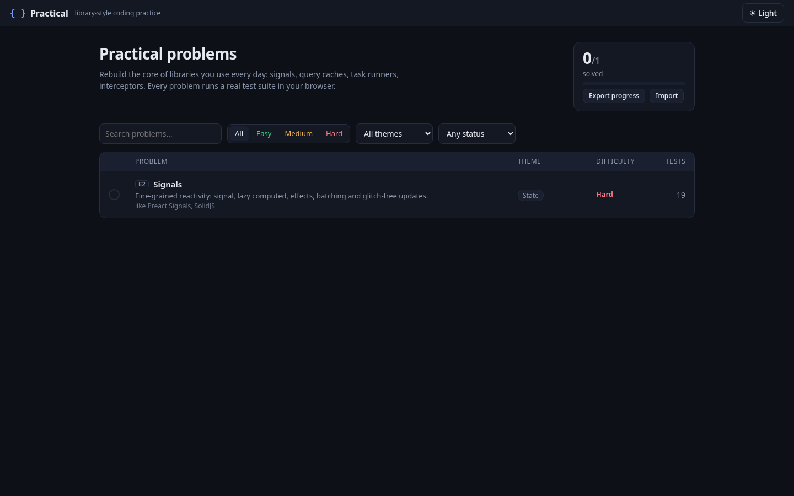

# Whetstone

**Practice coding on the problems real libraries solve.**

👉 **[Open Whetstone: farskid.github.io/whetstone](https://farskid.github.io/whetstone/)**

Free, in your browser, with no sign-up.

## What it is

Whetstone is a practice site for real-world coding problems. Instead of puzzles, you rebuild small versions of tools developers use every day: retries, caches, event emitters, routers, form state, rate limiters and more. There are 71 problems, from easy warm-ups to hard ones.

- **Problems that grow with you.** Most problems come in stages. You start with a small version, and each stage adds one new requirement, so the problem gets harder as you go.
- **Tests that go green as you solve.** Every problem has a list of tests you can see from the start. Run your code and watch them turn green one by one. When one fails, it shows what was expected and what you got.
- **A "Cracked" moment.** When you solve the whole problem, a short "Cracked" effect plays.
- **Write in TypeScript or JavaScript**, in an editor with autocomplete.
- **Your progress stays in your browser.** You can export it and import it on another computer.

Whetstone counts visits with [GoatCounter](https://www.goatcounter.com), a privacy-friendly counter that uses no cookies and collects nothing personal. [See the public stats](https://trywhetstonedev.goatcounter.com).

## Feedback and ideas

Found a bug, have an idea, or want a problem about a library you use? Click **"send feedback or something"** at the top of the site, or [open a feedback issue](https://github.com/farskid/whetstone/issues/new?template=feedback.yml). A rough note is enough.

## Run it yourself

1. Install [Node.js](https://nodejs.org/).
2. Download this repository and open a terminal in its folder.
3. Run `npm install`, then `npm run dev`.
4. Open http://localhost:5173 in your browser.

Want to add a problem or change how Whetstone works? See the [development guide](docs/DEVELOPMENT.md).
